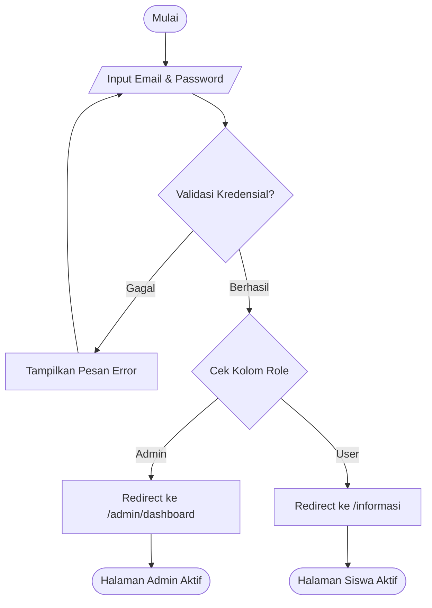
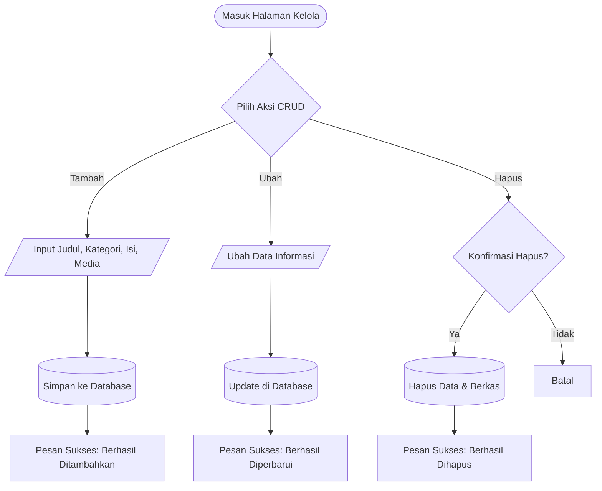
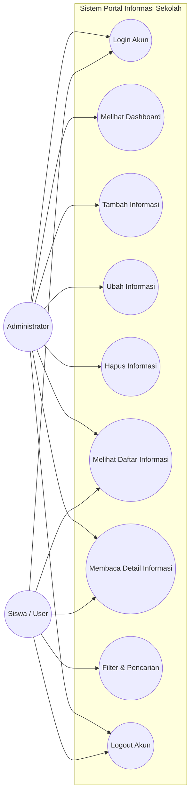
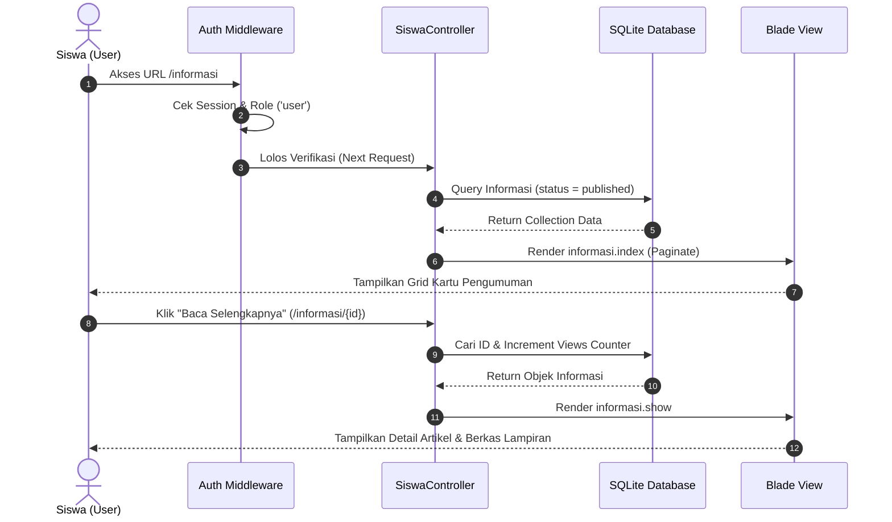
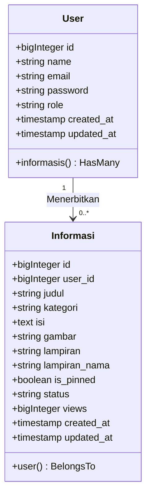
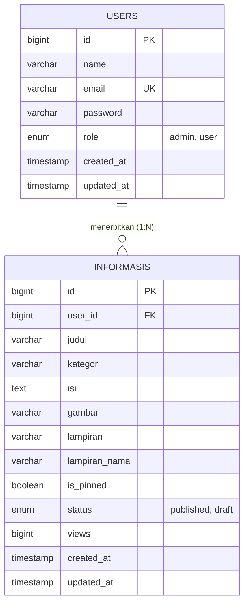

# LAPORAN PROJECT PRAKTIK
## SISTEM INFORMASI PENGUMUMAN SEKOLAH BERBASIS WEB

**Mata Pelajaran:** Praktik Rekayasa Perangkat Lunak (RPL)  
**Tingkat / Jurusan:** Kelas XI RPL  
**Arsitektur:** Model-View-Controller (MVC) — Laravel Framework  
**Tahun Ajaran:** 2026/2027  

---

### IDENTITAS SISWA
- **Nama Siswa:** ___________________________
- **Kelas:** XI RPL ___
- **Nomor Absen:** _____
- **Tanggal Pengumpulan:** _____ Oktober 2026

---

## DAFTAR ISI
1. [BAB I: ANALISIS SISTEM](#bab-i-analisis-sistem)
   - 1.1 Latar Belakang & Analisis Kebutuhan
   - 1.2 Identifikasi Aktor & Hak Akses
   - 1.3 Identifikasi Proses Bisnis Sistem
   - 1.4 Kebutuhan Data Sistem
   - 1.5 Hubungan Integrasi Data Admin dan Siswa
2. [BAB II: PERANCANGAN SISTEM](#bab-ii-perancangan-sistem)
   - 2.1 Flowchart Sistem (Alur Kerja)
   - 2.2 Unified Modeling Language (UML)
     - 2.2.1 Use Case Diagram
     - 2.2.2 Activity Diagram
     - 2.2.3 Class Diagram
   - 2.3 Rancangan Basis Data (Database Design & ERD)
   - 2.4 Rancangan Antarmuka Pengguna (UI Wireframe / Mockup)
3. [BAB III: IMPLEMENTASI SISTEM](#bab-iii-implementasi-sistem)
   - 3.1 Struktur Arsitektur MVC Laravel
   - 3.2 Implementasi Database Migration & Seeder
   - 3.3 Konfigurasi Routing & Middleware Keamanan
   - 3.4 Implementasi Controller & Logika CRUD
   - 3.5 Implementasi View Blade & Styling
4. [BAB IV: PENGUJIAN SISTEM (BLACK BOX TESTING)](#bab-iv-pengujian-sistem-black-box-testing)
5. [BAB V: KESIMPULAN & SARAN](#bab-v-kesimpulan--saran)
6. [LAMPIRAN: DOKUMENTASI & TANGKAPAN LAYAR (SCREENSHOT)](#lampiran-dokumentasi--tangkapan-layar-screenshot)

---

## BAB I: ANALISIS SISTEM

### 1.1 Latar Belakang & Analisis Kebutuhan
Dalam era keterbukaan informasi di lingkungan pendidikan kejuruan, penyampaian pengumuman akademik, jadwal ujian, penempatan Praktik Kerja Lapangan (PKL), dan kegiatan ekstrakurikuler seringkali terkendala apabila masih mengandalkan papan mading fisik atau selebaran kertas. Informasi fisik rentan hilang, rusak, serta lambat diakses oleh peserta didik.

Oleh karena itu, dibutuhkan sebuah **Portal Informasi & Pengumuman Sekolah Berbasis Web** yang mengadopsi arsitektur *Role-Based Access Control* (RBAC). Sistem ini memisahkan secara tegas kewenangan antara pengelola informasi (Admin) dan penerima informasi (Siswa).

### 1.2 Identifikasi Aktor & Hak Akses
Sistem ini melibatkan 2 (dua) aktor utama:

| Aktor | Peran Utama | Batasan & Hak Akses |
|---|---|---|
| **Administrator (Admin)** | Pengelola konten sekolah | Memiliki hak akses penuh (*Superuser*) untuk: <br>1. Masuk (*login*) ke sistem.<br>2. Mengakses halaman Dashboard statistik.<br>3. Melakukan operasi CRUD penuh (*Create, Read, Update, Delete*) data pengumuman.<br>4. Mengelola status publikasi (Terbit/Draf) dan menyematkan pengumuman penting (*Pin*). |
| **Siswa (User)** | Konsumen informasi sekolah | Memiliki hak akses *Read-Only* untuk: <br>1. Masuk (*login*) ke sistem.<br>2. Membaca daftar pengumuman terbaru.<br>3. Melakukan pencarian dan penyaringan (*filter*) kategori.<br>4. Membaca uraian detail pengumuman dan mengunduh berkas lampiran.<br>5. **Dilarang keras** mengakses modul kelola admin (URL `/admin/*`). |

### 1.3 Identifikasi Proses Bisnis Sistem
1. **Proses Autentikasi Tunggal:** Admin dan Siswa menggunakan satu gerbang pintu masuk yang sama (`GET /login`). Sistem memverifikasi kredensial email dan kata sandi menggunakan hash terenkripsi.
2. **Proses Percabangan Pasca-Login (*Role Routing*):**
   - Jika `role == 'admin'`, sistem secara otomatis mengarahkan ke `/admin/dashboard`.
   - Jika `role == 'user'`, sistem secara otomatis mengarahkan ke `/informasi`.
3. **Proses Pengelolaan Konten (Admin):** Admin menginput judul, kategori, uraian isi, berkas gambar sampul, berkas lampiran dokumen, dan status terbit. Setiap perubahan disimpan ke basis data secara langsung.
4. **Proses Konsumsi Konten (Siswa):** Siswa membuka daftar pengumuman yang diurutkan dari pengumuman yang disematkan (*pinned*) kemudian berdasarkan waktu rilis terbaru (*latest*).

### 1.4 Kebutuhan Data Sistem
Data yang wajib dikelola mencakup:
1. **Data Pengguna (`users`):** `id`, `name`, `email`, `password`, `role` (`'admin' | 'user'`).
2. **Data Informasi (`informasis`):** `id`, `user_id` (relasi ke penulis), `judul`, `kategori`, `isi`, `gambar`, `lampiran`, `is_pinned`, `status`, `views`, `created_at`, `updated_at`.

### 1.5 Hubungan Integrasi Data Admin dan Siswa
Data yang dikelola Admin berelasi satu arah menuju antarmuka publik Siswa:
- Ketika Admin membuat pengumuman dengan status `published`, data langsung muncul di halaman Siswa.
- Ketika Admin mengubah judul/isi pengumuman, halaman detail Siswa otomatis menampilkan pembaruan terkini.
- Ketika Admin menghapus pengumuman, integritas relasi basis data menghapus data beserta berkas terkait, sehingga siswa tidak dapat lagi mengakses pengumuman tersebut.

---

## BAB II: PERANCANGAN SISTEM

### 2.1 Flowchart Sistem (Alur Kerja)

#### A. Flowchart Autentikasi & Percabangan Role


#### B. Flowchart Manajemen CRUD Informasi (Admin)


---

### 2.2 Unified Modeling Language (UML)

#### 2.2.1 Use Case Diagram


#### 2.2.2 Activity Diagram: Alur Siswa Mengakses Pengumuman


#### 2.2.3 Class Diagram


---

### 2.3 Rancangan Basis Data (Database Design & ERD)

Sistem menggunakan basis data relasional konsisten dengan aturan *referential integrity*:



#### Spesifikasi Kamus Data Tabel `users`:
| Nama Kolom | Tipe Data | Nullable | Keterangan |
|---|---|---|---|
| `id` | BIGINT (Unsigned) | No | Primary Key, Auto Increment |
| `name` | VARCHAR(255) | No | Nama lengkap pengguna |
| `email` | VARCHAR(255) | No | Alamat email unik untuk login |
| `password` | VARCHAR(255) | No | Hash Bcrypt kata sandi |
| `role` | ENUM('admin', 'user') | No | Default: `'user'` |
| `created_at` | TIMESTAMP | Yes | Waktu pendaftaran |
| `updated_at` | TIMESTAMP | Yes | Waktu perubahan data |

#### Spesifikasi Kamus Data Tabel `informasis`:
| Nama Kolom | Tipe Data | Nullable | Keterangan |
|---|---|---|---|
| `id` | BIGINT (Unsigned) | No | Primary Key, Auto Increment |
| `user_id` | BIGINT (Unsigned) | No | Foreign Key merujuk ke `users(id)` ON DELETE CASCADE |
| `judul` | VARCHAR(255) | No | Judul berita/pengumuman |
| `kategori` | VARCHAR(50) | No | Kategori (Akademik, Pengumuman, Ekstrakurikuler) |
| `isi` | TEXT | No | Uraian lengkap pengumuman |
| `gambar` | VARCHAR(255) | Yes | Path penyimpanan gambar banner |
| `lampiran` | VARCHAR(255) | Yes | Path penyimpanan berkas lampiran resmi |
| `lampiran_nama`| VARCHAR(255) | Yes | Nama asli berkas lampiran |
| `is_pinned` | BOOLEAN | No | Penanda pengumuman penting (default: false) |
| `status` | ENUM('published','draft') | No | Status publikasi (default: 'published') |
| `views` | BIGINT | No | Penghitung jumlah pembaca (default: 0) |
| `created_at` | TIMESTAMP | Yes | Waktu rilis pengumuman |
| `updated_at` | TIMESTAMP | Yes | Waktu penyuntingan pengumuman |

---

### 2.4 Rancangan Antarmuka Pengguna (UI Wireframe)

1. **Halaman Login (`/login`):**
   - Menggunakan kartu terpusat (*centered card*) dengan logo teks sekolah, form input email, kata sandi, dan tombol "Masuk ke Portal". Terdapat informasi akun uji coba demo di bagian bawah.
2. **Halaman Dashboard Admin (`/admin/dashboard`):**
   - Bagian atas memuat 4 kartu ringkasan indikator: Total Pengumuman, Terbit/Draf, Total Pembaca, Total Pengguna.
   - Tombol aksi primer "+ Tambah Informasi Baru".
   - Filter bar pencarian kata kunci dan kategori.
   - Tabel responsif dengan aksi tombol Edit dan tombol Hapus (form DELETE).
3. **Halaman Siswa (`/informasi`):**
   - Header bertema editorial koran/jurnal bersih (*Source Serif & Plus Jakarta Sans*).
   - Kotak pencarian judul/isi dan tombol tab filter kategori.
   - Grid kartu 2-kolom memuat gambar thumbnail, label kategori, tanggal, counter pembaca, judul, cuplikan paragraf, dan tautan "Baca Selengkapnya".
4. **Halaman Detail Pengumuman (`/informasi/{id}`):**
   - Tombol kembali dan tombol cetak printer.
   - Gambar banner utama, metadata penulis dan tanggal, konten paragraf lega, kotak unduh dokumen lampiran resmi, serta daftar pengumuman terkait di bagian kaki artikel.

---

## BAB III: IMPLEMENTASI SISTEM

### 3.1 Struktur Arsitektur MVC Laravel
Sistem dibangun di atas fondasi kerangka kerja Laravel dengan pemisahan komponen:
- **Model:** Menangani representasi data dan relasi Eloquent (`app/Models/User.php`, `app/Models/Informasi.php`).
- **View:** Bertanggung jawab atas visual antarmuka pengguna berbasis template engine Blade dan Tailwind CSS CDN (`resources/views/`).
- **Controller:** Pengatur alur logika bisnis (`AuthController`, `Admin\DashboardController`, `Admin\InformasiController`, `SiswaController`).
- **Middleware:** Garda keamanan otorisasi perutean (`CheckRole`).

### 3.2 Implementasi Database Migration & Seeder
Migration tabel dibuat bersih tanpa kolom eksperimental yang tidak perlu:
- **File Migration `users`:** Menambahkan kolom enum `role` bernilai `['admin', 'user']`.
- **File Migration `informasis`:** Mengaitkan relasi `user_id` dengan integritas cascade delete.
- **File Seeder (`DatabaseSeeder.php`):** Mengisi 2 akun uji coba (`admin@sekolah.test` dan `siswa@sekolah.test`) beserta 4 pengumuman awal realistis seputar kegiatan SMK.

### 3.3 Konfigurasi Routing & Middleware Keamanan
File `routes/web.php` dikonfigurasi dengan ketat mematuhi batasan akses. Sesuai instruksi pengerjaan mandiri, baris pertama file rute diberi komentar penanda:
```php
<?php // Dikerjakan secara mandiri
// Dikerjakan secara mandiri
```

Middleware `CheckRole` memverifikasi sesi aktif pengguna. Apabila peran akun tidak cocok dengan rute tujuan (misal: Siswa mencoba mengakses URL Admin), sistem langsung memblokir akses dan mengembalikan respons HTTP `403`:
```php
if (! $request->user() || $request->user()->role !== $role) {
    abort(403, 'Akses Ditolak');
}
```

### 3.4 Implementasi Controller & Logika CRUD
- **`AuthController`:** Mengatur autentikasi sesi dan melakukan redirect bersyarat:
  - Admin $\rightarrow$ `/admin/dashboard`
  - Siswa $\rightarrow$ `/informasi`
- **`Admin\InformasiController`:** Mengimplementasikan validasi input wajib (`judul`, `kategori`, `isi`), penyimpanan otomatis `user_id => auth()->id()`, pengunggahan berkas media, dan pengalihan dengan *flash session message*.
- **`SiswaController`:** Menjalankan pengambilan data pengumuman aktif berpaginasi, penyaringan kata kunci `LIKE %query%`, serta penambahan counter `views` setiap halaman detail diakses.

---

## BAB IV: PENGUJIAN SISTEM (BLACK BOX TESTING)

Pengujian fungsionalitas sistem dilakukan menggunakan metode pengujian kotak hitam (*Black Box Testing*):

| No | Skenario Uji | Prosedur Uji | Hasil yang Diharapkan | Status |
|:--:|---|---|---|:--:|
| 1 | **Login Admin** | Masukkan email `admin@sekolah.test` dan password `password` | Berhasil login dan langsung dialihkan ke `/admin/dashboard` | **BERHASIL** |
| 2 | **Login Siswa** | Masukkan email `siswa@sekolah.test` dan password `password` | Berhasil login dan langsung dialihkan ke `/informasi` | **BERHASIL** |
| 3 | **Proteksi Bypass URL** | Akun Siswa aktif membuka paksa URL `/admin/dashboard` di address bar | Sistem menolak akses dan memunculkan error HTTP `403 Akses Ditolak` | **BERHASIL** |
| 4 | **Proteksi Guest** | Pengguna belum login mengakses URL `/informasi` atau `/admin/dashboard` | Sistem menolak dan melempar kembali ke form login (`/login`) | **BERHASIL** |
| 5 | **Tambah Pengumuman (Create)** | Admin mengisi form pengumuman baru lalu klik simpan | Data tersimpan di basis data, muncul pesan flash sukses, dan pengumuman tampil di halaman siswa | **BERHASIL** |
| 6 | **Validasi Form Kosong** | Admin mengosongkan judul/isi saat submit | Form menampilkan pesan validasi error dan data tidak tersimpan | **BERHASIL** |
| 7 | **Ubah Pengumuman (Update)** | Admin memperbarui judul atau kategori pengumuman | Data di tabel admin dan halaman siswa langsung terbarui secara sinkron | **BERHASIL** |
| 8 | **Hapus Pengumuman (Delete)** | Admin menghapus salah satu pengumuman | Data hilang permanen dari basis data dan lenyap dari halaman siswa | **BERHASIL** |
| 9 | **Pencarian Informasi** | Siswa mengetikkan kata kunci pada kotak pencarian di `/informasi` | Sistem hanya memfilter kartu informasi yang judul/isinya cocok | **BERHASIL** |
| 10 | **Increment View Counter** | Siswa membuka salah satu artikel pengumuman | Jumlah angka pembaca bertambah +1 pada database dan view | **BERHASIL** |
| 11 | **Ganti Kata Sandi** | Pengguna membuka `/profil` dan mengganti kata sandi | Kata sandi terbarui dalam hash bcrypt dan dapat dipakai login ulang | **BERHASIL** |
| 12 | **Logout Sistem** | Pengguna menekan tombol "Keluar" di navbar | Sesi dan token dihapus, dialihkan kembali ke `/login` | **BERHASIL** |

---

## BAB V: KESIMPULAN & SARAN

### 5.1 Kesimpulan
Berdasarkan hasil analisis, perancangan, implementasi, dan pengujian yang telah dilaksanakan, dapat disimpulkan bahwa:
1. Sistem Informasi Pengumuman Sekolah Berbasis Web telah berhasil dibangun memenuhi seluruh kriteria fungsional studi kasus dengan menerapkan arsitektur MVC (Model-View-Controller) Laravel Framework.
2. Mekanisme pemisahan peran (*Role-Based Access Control*) antara Administrator dan Siswa berfungsi dengan baik dan aman dari upaya bypass URL ilegal berkat penerapan custom middleware `CheckRole`.
3. Siklus pengelolaan data (CRUD) terintegrasi secara dinamis dari database menuju antarmuka siswa tanpa adanya data yang bersifat statis (*hardcoded*).
4. Tampilan antarmuka menggunakan Tailwind CSS dirancang dengan pendekatan editorial bersih, responsif, dan bebas dari elemen visual yang berlebihan.

### 5.2 Saran Pengembangan Lanjutan
Untuk pengembangan sistem pada tahap berikutnya, disarankan penambahan:
1. Pengiriman notifikasi pengumuman mendesak secara otomatis melalui integrasi API WhatsApp atau Telegram bot sekolah.
2. Penambahan peran akun Guru untuk menginput tugas mata pelajaran kejuruan mandiri.
3. Fitur riwayat log aktivitas (*audit trail*) untuk mencatat seluruh tindakan penyuntingan konten oleh administrator.

---

## LAMPIRAN: DOKUMENTASI & TANGKAPAN LAYAR (SCREENSHOT)

*(Bagian ini memuat bukti visual antarmuka sistem yang telah diimplementasikan dan berjalan sesuai dengan instruksi pengumpulan tugas praktik.)*

### 1. Halaman Login Bersama (`/login`)
> *Deskripsi:* Gerbang masuk tunggal untuk Admin dan Siswa dilengkapi validasi kredensial dan informasi akun pengujian demo.
> 
> *(Sisipkan Gambar 1: Tangkapan layar halaman Login)*

---

### 2. Halaman Dashboard Admin (`/admin/dashboard`)
> *Deskripsi:* Antarmuka administrator yang menampilkan 4 indikator ringkasan statistik (Total Pengumuman, Terbit/Draf, Total Pembaca, Total Pengguna) serta tabel pengelolaan pengumuman.
> 
> *(Sisipkan Gambar 2: Tangkapan layar halaman Dashboard Admin)*

---

### 3. Formulir Tambah Pengumuman Baru (`/admin/informasi/create`)
> *Deskripsi:* Formulir input pengumuman yang dilengkapi pemilihan kategori, status publikasi, unggah gambar sampul/banner, unggah lampiran dokumen, dan opsi pin pengumuman penting.
> 
> *(Sisipkan Gambar 3: Tangkapan layar form Tambah Pengumuman)*

---

### 4. Halaman Formulir Ubah Pengumuman (`/admin/informasi/{id}/edit`)
> *Deskripsi:* Formulir penyuntingan yang memuat data pengumuman yang sudah terbit beserta opsi mengganti/menghapus berkas lampiran sebelumnya.
> 
> *(Sisipkan Gambar 4: Tangkapan layar form Edit Pengumuman)*

---

### 5. Halaman Utama Siswa / Papan Pengumuman (`/informasi`)
> *Deskripsi:* Tampilan grid kartu pengumuman untuk siswa dengan label kategori berwarna, indikator pin pengumuman penting, thumbnail gambar, counter pembaca, kotak pencarian, dan filter tab kategori.
> 
> *(Sisipkan Gambar 5: Tangkapan layar Halaman Siswa)*

---

### 6. Halaman Detail Pengumuman Siswa (`/informasi/{id}`)
> *Deskripsi:* Halaman uraian artikel pengumuman dengan gambar banner penuh, tipografi editorial yang nyaman dibaca, tombol unduh dokumen lampiran resmi, tombol cetak, dan daftar pengumuman terkait.
> 
> *(Sisipkan Gambar 6: Tangkapan layar Halaman Detail Pengumuman)*

---

### 7. Bukti Pengujian Keamanan Otorisasi (Bypass URL 403 Forbidden)
> *Deskripsi:* Bukti penolakan akses oleh Middleware `CheckRole` ketika akun Siswa mencoba mengakses URL internal Admin secara langsung.
> 
> *(Sisipkan Gambar 7: Tangkapan layar HTTP 403 Akses Ditolak)*

---

*Laporan ini disusun secara mandiri sebagai bentuk pertanggungjawaban penyelesaian project praktik kejuruan Rekayasa Perangkat Lunak.*
